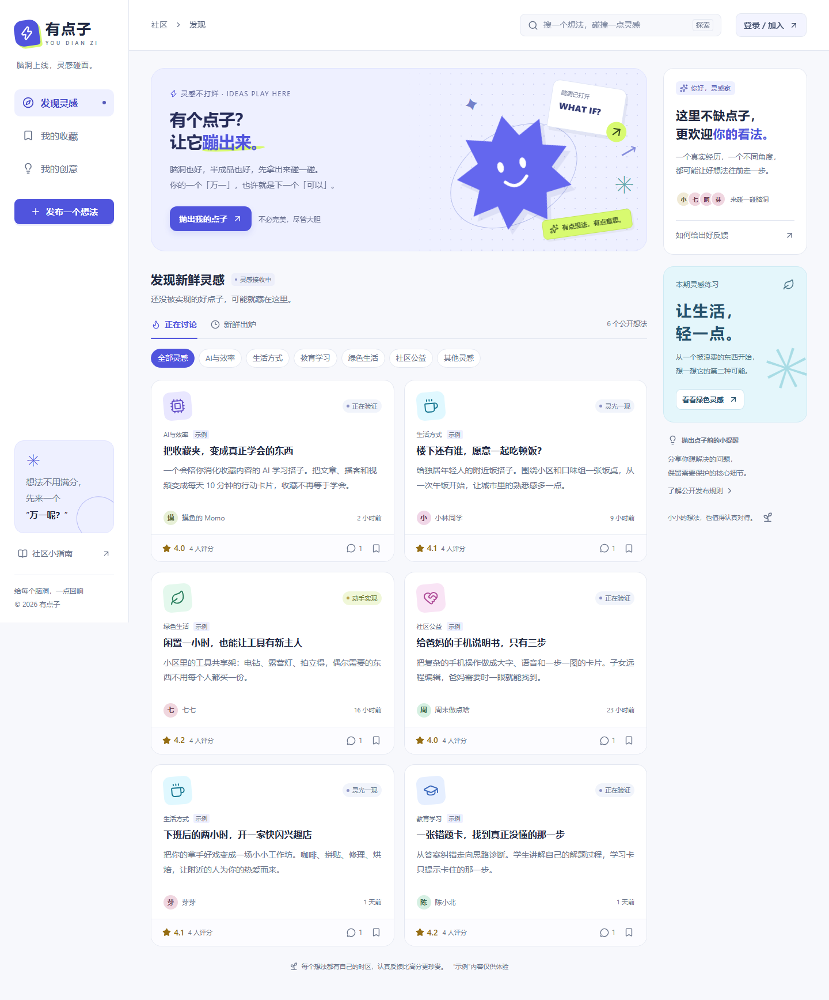
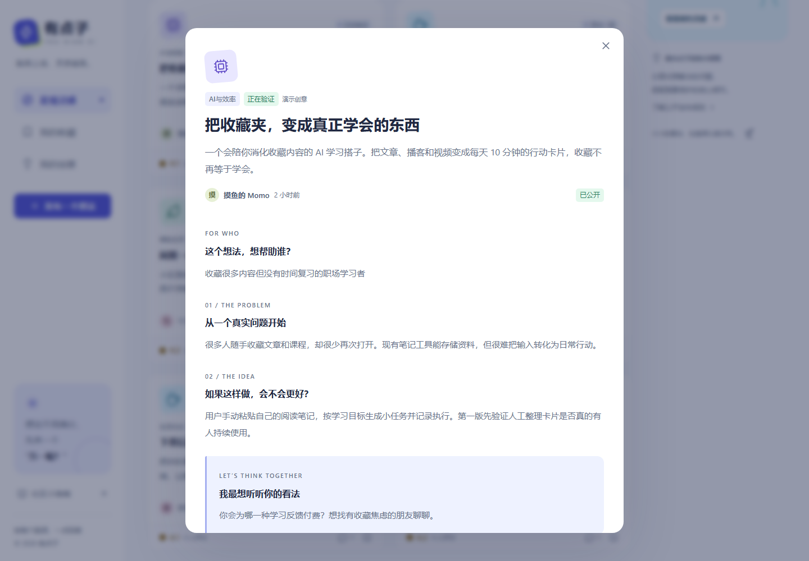
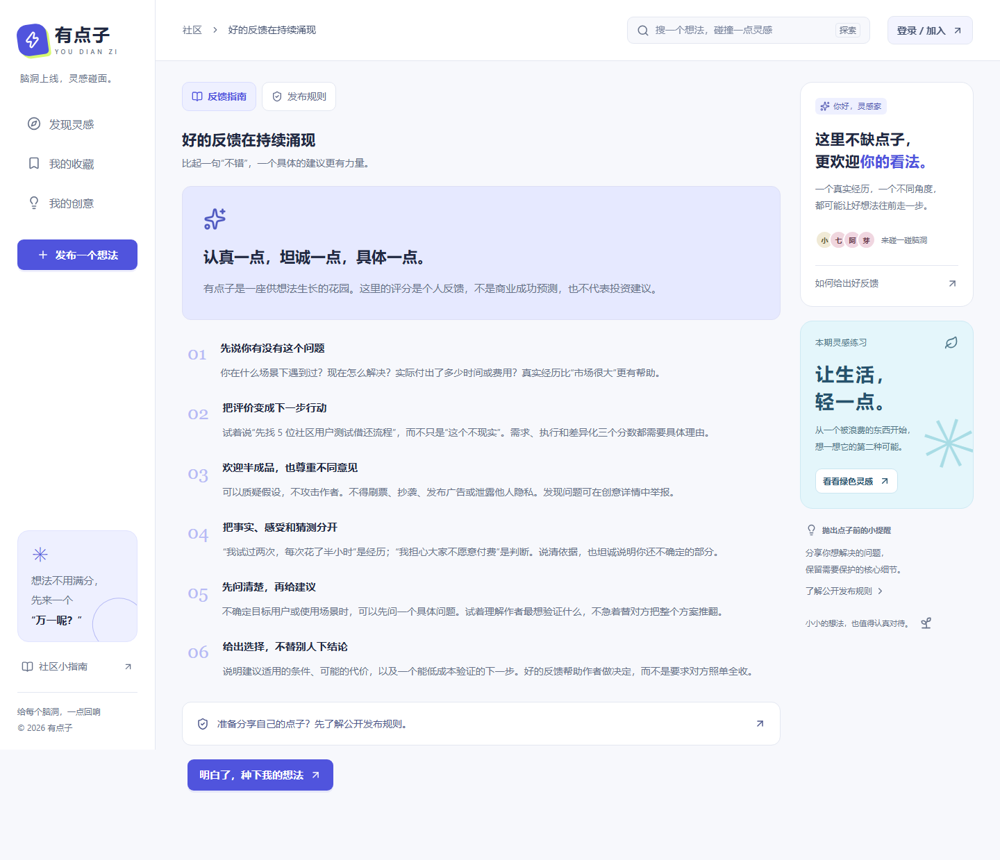
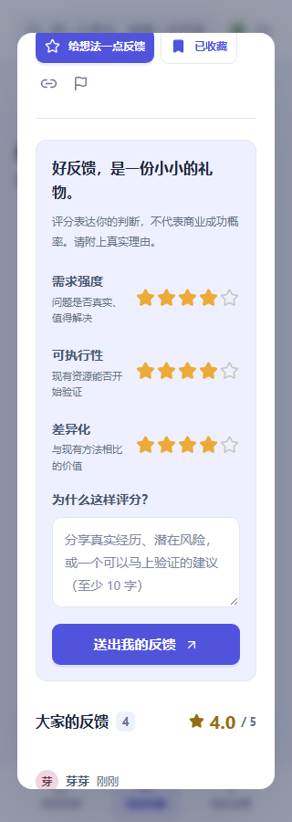

# 有点子 · YOU DIAN ZI

**有个点子？让它蹦出来。**

一个分享真实问题、交流新鲜想法、收集具体反馈的中文创意社区。

产品展示仓库 · 不提供产品源码 · 在线演示暂未开放

[产品介绍](#产品介绍) · [页面预览](#页面预览) · [在线演示](#在线演示) · [使用与权利说明](RIGHTS.md)

## 产品介绍

不必等到想法完美，才开始和别人聊聊。

「有点子」希望让还没成形的想法也能被认真对待：从一个具体问题出发，讲清楚你想帮助谁、打算如何解决，再听听别人的经历、疑问和建议。

- **发现灵感**：按兴趣分类浏览，也可以搜索关键词、查看新想法和正在讨论的话题。
- **讲清点子**：用目标人群、真实问题、解决方式和期待反馈，把模糊念头整理成可讨论的内容。
- **收集反馈**：围绕需求强度、可执行性与差异化评分，并给出具体理由；支持评论交流和收藏。
- **自主决定公开**：先保存私密草稿，准备好后确认公开授权、提交审核；公开后仍可撤下修改。
- **随时参与**：适配桌面和手机，保留轻盈、活泼的创意社区体验。

评分表达参与者的判断，不代表商业成功概率，也不构成投资建议。

## 页面预览

以下为开发中的 MVP 页面，使用隔离测试环境中的虚拟创意、示例昵称与反馈；不包含真实用户数据，也不代表实际运营规模。截图更新于 **2026-10-12**，后续界面可能调整。

### 把问题讲清楚，让反馈更具体

### 认真一点，坦诚一点，具体一点

### 灵感也可以随身带着走

  
  &nbsp;&nbsp;
  

## 在线演示

**暂未开放。** 当前尚无可公开访问的线上演示网址。

开放体验后，经过确认的正式链接会更新在本节。现在可以通过上方截图了解产品；本仓库不提供安装包、源码或自部署入口。

## 项目动态与反馈

- 关注本仓库，了解产品展示与体验入口的更新。
- 产品建议可以提交到 [Issues](https://github.com/Samhom/youdianzi-showcase/issues)。请勿上传手机号、密码、验证码或其他敏感信息。
- 开发者主页：[Samhom](https://github.com/Samhom)。

## 仓库范围

本仓库只保存产品介绍、演示截图和体验入口说明。产品的前后端源码、构建产物、部署配置、数据库、账户凭据及开发历史均不在本仓库中提供。

公开展示不等于开源授权，也不代表允许复制产品或另行部署运营。有关本仓库资料的使用边界，见 [使用与权利说明](RIGHTS.md)。
